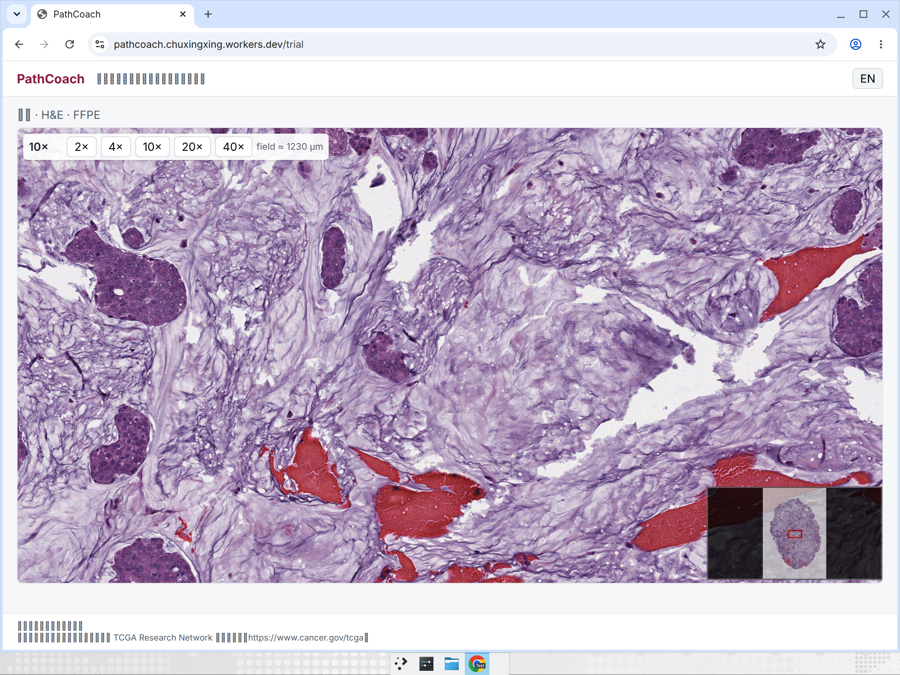
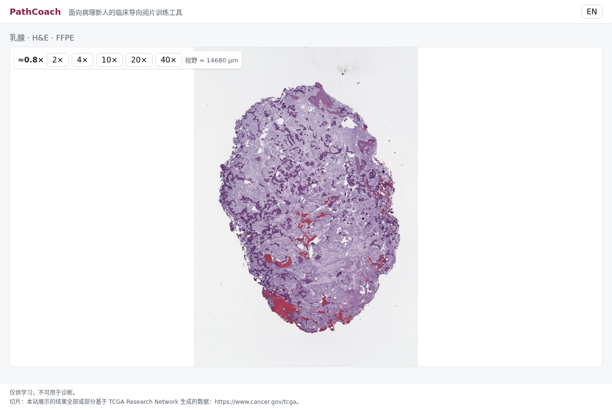

# R0 · 架构与数据模型 审核包（v2，已按自审意见修订）

> 阶段：M0 项目初始化 · 计划：[`docs/plan.md`](../plan.md) · 规格：[`docs/spec-v2.md`](../spec-v2.md)（MVP 定稿 v2.0 公开版）· 设计决策：[`docs/decisions.md`](../decisions.md) · 自审意见及处理：[`R0-selfreview.md`](R0-selfreview.md)
> 公开网址：https://pathcoach.chuxingxing.workers.dev（试验切片：`/trial`）· 代码：https://github.com/Chuxingxing701/pathcoach/pull/1

## 1. 目标 vs 实际

| 计划项                                       | 状态         | 说明                                                                                                                               |
| -------------------------------------------- | ------------ | ---------------------------------------------------------------------------------------------------------------------------------- |
| 仓库 + Vite/TS 骨架 + lint/format/typecheck  | ✅           | React 19 + TS strict + ESLint + Prettier；`npm run check` 全绿                                                                     |
| GitHub Actions（check + build）              | ✅           | `.github/workflows/ci.yml`，在 PR #1 上运行                                                                                        |
| 数据结构类型 + JSON Schema + 校验脚本        | ✅           | `src/types.ts`；`schemas/*.schema.json`；`npm run validate:data` 校验 manifest ↔ case ↔ template ↔ answer 一致性，并做标签泄漏检查 |
| Cloudflare 部署跑通，占位页上线              | ✅           | Worker `pathcoach`，`npm run deploy`                                                                                               |
| 瓦片存储                                     | ✅（改方案） | 不用 R2（需绑卡，Chu 拒绝）→ 静态资源 Worker `pathcoach-tiles-1`，见 ADR-003                                                       |
| 1 张切片端到端（SVS→DZI→托管→OpenSeadragon） | ✅           | TCGA-BRCA 试验切片：8 秒切完，251 张瓦片 / 37 MB；缩放、平移、小地图、等效倍数、2×–40× 按钮和 1–5 快捷键可用                       |
| `docs/decisions.md`                          | ✅           | ADR-001 ~ 006                                                                                                                      |

## 2. 设计取舍（详见 decisions.md）

- **ADR-003 瓦片不放 R2**：1024 px 瓦片、跳过空白、最高存 20×（40× 为放大显示）。实测最大的一张候选肺切片（TCGA-LUAD DX，SVS 157 MB）切出 1,109 张瓦片 / 103 MB，28 张最坏约 3.1 万个文件，最多 2 个瓦片 Worker。静态资源请求免费且不限量（ADR 内附 Cloudflare 官方链接）。代价：真 40× 细节丢失。
- **ADR-004 标签和出处都不进病例文件**：`answers/<id>.json` 存 `truth`、`primaryDiagnosis` 和 GDC 出处 `source`，只在提交后请求；病例 ID、DZI 文件名、瓦片路径一律无含义编号。`validate:data` 遇到 `TCGA / LUAD / LUSC / normal / adeno / squam / carcinoma`、sample type 或条码（`-01A` / `-11A`）就报错。静态站无法防刻意作弊，只防误见；n=1 自测接受这一风险。偏离 v2.0 §7（truth 原在 case.json）。
- **ADR-005 试验切片用乳腺**：Chu 在练前测前不能看到任何肺切片；代价是「其他部位」少了乳腺这个选项。
- **schema 相对 v2.0 的增改**：`specimen`（FFPE / frozen）、`clinical.packYears`、`tiles{dzi,mpp,width,height,scanMag}`、出处 `source` 放进 answer、模板步骤加 `kind` 和 `levels`；`split` 增加 `trial`；新增 `TestResult`（练前 / 练后测，含自信度与用时）。
- **模板规则**：有 `hint` 的条目必须至少 1 个来源（schema 强制，落实「提示 100% 带出处」）。
- **文档语言**：审核包用中文（给 Chu 审核），ADR 和 README 用英文（公开仓库）。

## 3. 已知问题 / 技术债

- JS 包 573 KB（OpenSeadragon 为主），后续按路由拆包。
- 跳过的空白瓦片返回 404，浏览器控制台会有 404 记录；OpenSeadragon 默认 `tileRetryMax=0`，不会重试，显示为白色。
- 倍数是屏幕等效倍数（10× 下 1 屏幕像素 ≈ 1 µm），界面已标「≈」并有悬停说明；真实 10× 物镜视野直径约 2 mm，两者不同。
- 国内访问速度未实测（`workers.dev` 在大陆可能不稳定）；本机（海外）首页 0.17 s、瓦片约 0.08 s / 张。R5 前请 Chu 在国内网络下打开一次。
- 中文显示：之前截图里中文是方块，原因是测试机的 Chrome 在装中文字体前就已启动；换新启动的 Chrome 后显示正常（见上图）。CSS 字体栈已补 `Noto Sans CJK SC` / `Source Han Sans SC` / `Hiragino Sans GB`，覆盖 Linux / 安卓 / 老 macOS。

## 4. 需要拍板

1. **ADR-006 正常肺只有冰冻切片**：GDC 上 TCGA 肺的 591 张 Solid Tissue Normal 全是冰冻切片，诊断用 FFPE 切片只有肿瘤。提议：每一类的冰冻 / FFPE 比例相同（练习集每类 2 冰冻 + 2 FFPE，练前 / 练后测每类 1 + 1），制片方式标在病例卡上；R1 前再查 GTEx 正常肺能否替代。R1 前定。
2. ADR-003 的 20× 上限是否可接受。
3. ADR-004 偏离 v2.0 §7 是否同意。

## 5. 验证证据

- `npm run check`、`npm run build` 通过；PR #1 CI
- 泄漏检查反向测试：在 case 文件写入 `TCGA-LUAD` 后 `validate:data` 报 `✗ case trial-brca-01: label hint "TCGA" in a pre-submit file (ADR-004)` 并退出 1
- 线上：`/`、`/trial`、`/data/manifest.json` 均 200；DZI 带 `Access-Control-Allow-Origin: *` 和一年缓存
- 截图见上

## 6. 下一阶段（M1 数据管线）

按 GDC API 挑 28 张（open access、SVS ≤ 150 MB、有 mpp、有 clinical，冰冻 / FFPE 按 ADR-006 分层）→ 切瓦片 → 部署 tile Worker → 生成 case / answer JSON（无含义编号）；并行跑 WSInfer 在 2 张 LUSC 上的实测。
